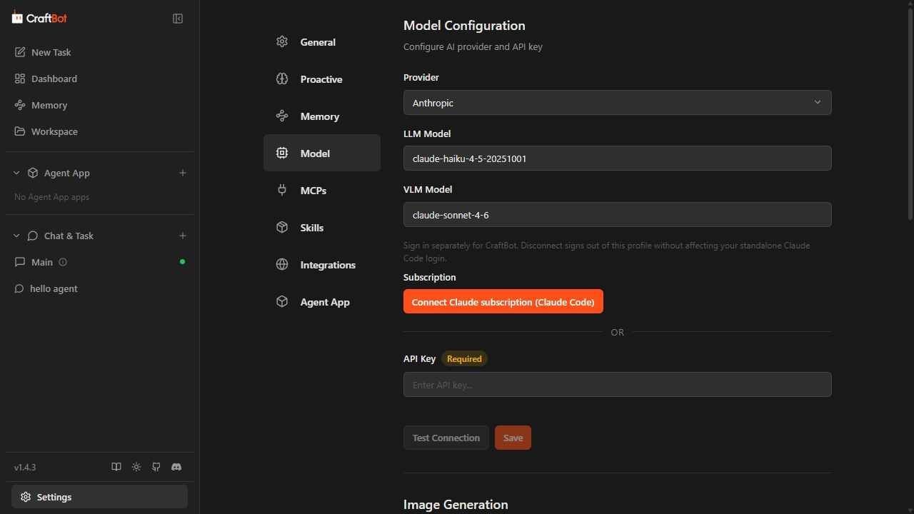
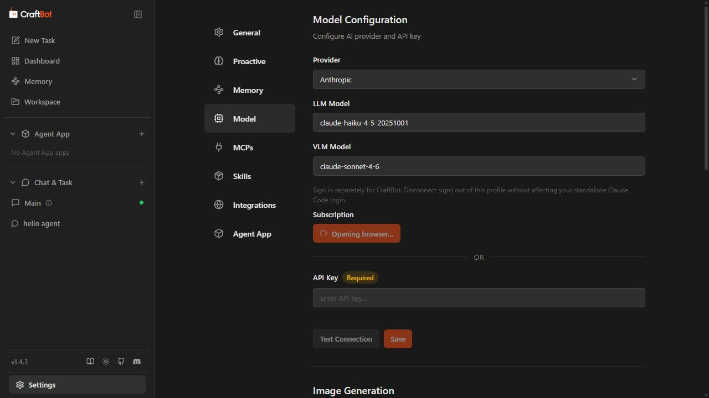
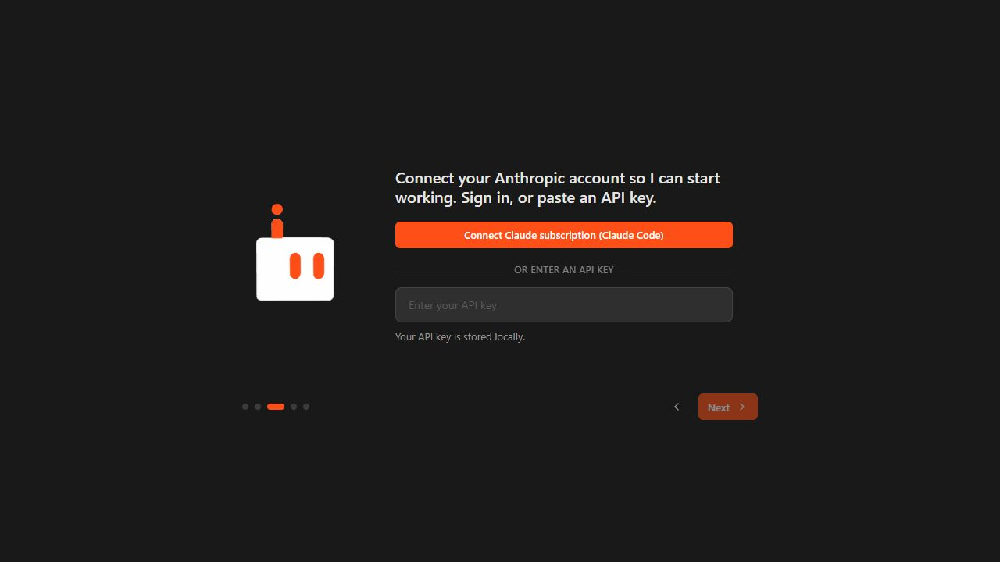
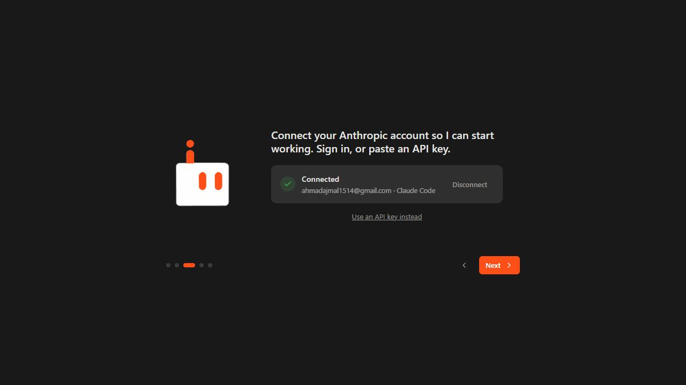
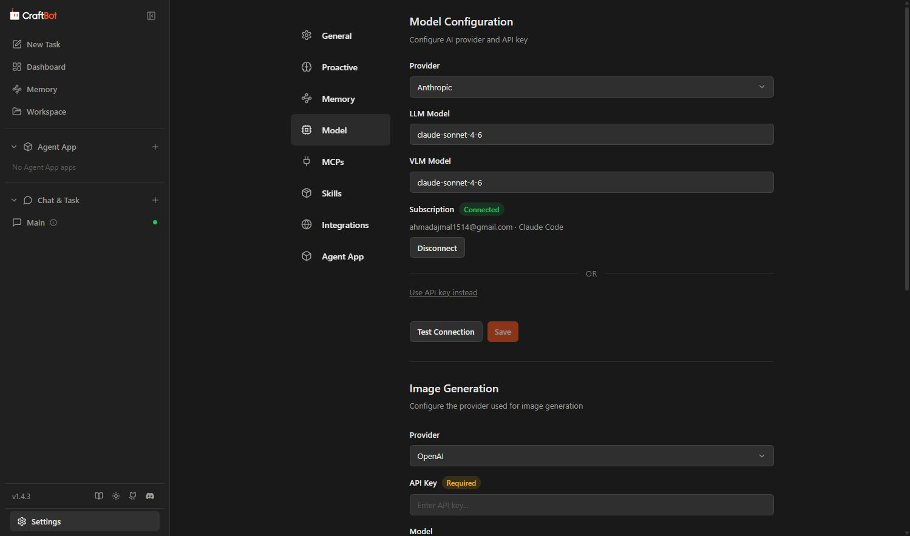
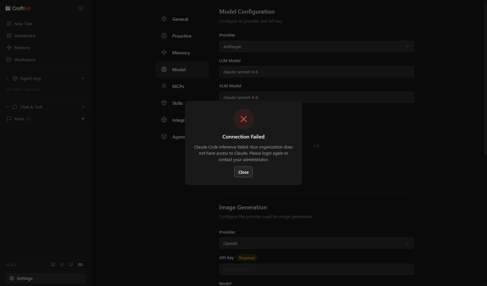
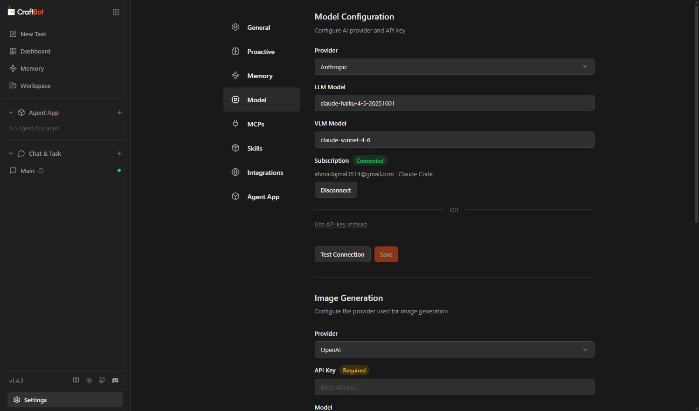
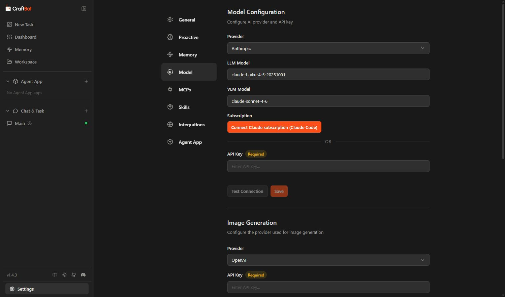

# Claude subscription validation report

## Review fixes: 21 October 2026

- Claude Code now receives an explicit thinking disable override when the
  Messages transport omits thinking for an Off choice. The model reasoning
  registry determines whether omission means Off, preserving provider defaults
  on models that think by default. Inherited CLI reasoning preferences are
  removed before applying the request's choice.
- Browser settings reads, saves, rollbacks and subscription activation offload
  live subscription checks. Live interface reinitialization stays on the event
  loop. Synchronous onboarding validates the saved connection flag and skips
  unused live status in settings-update results.
- The shared subscription button label is **Sign in with Claude** in both
  onboarding and Model settings.
- Removed the stale OmniRoute test case while retaining the request-shaping
  checks on LM Studio. This exposed a context-budget bug: Chat Completions
  reserved the uncapped output limit even when the request used a lower
  provider ceiling. The context check now reserves the value actually sent,
  with boundary regressions for Qwen, Groq, NVIDIA and Cerebras.
- Focused subscription/reinitialization tests: **56 passed**, including 19 new
  regression cases for reasoning choices and event-loop isolation.
- Combined subscription, reinitialization, factory, reasoning, golden-payload,
  reliability, context-budget and Supabase conformance tests: **1000 passed**.
  `test_provider_request_quirks` now passes.
- Additional session-resume and context-readout regressions: **36 passed**
  (**1036 passed** across the validation runs).
- Real installed Claude Code 2.1.50 against a local stub server: Off omits
  thinking from the Messages request; High sends adaptive thinking with effort
  high. Both return the stub response through `ClaudeCodeClient`. No real
  account credentials or paid model requests were used for this check.
- Repository-wide lint passes after removing the redundant late SQLite import
  and splitting the Supabase SQL parser's statements onto separate lines.
  Changed Python code passes formatting, compilation and whitespace checks.

Authenticated private-profile login/logout and live inference acceptance remain
pending as described below.

## Current implementation: separate Claude login profile

Updated on 20 October 2026 to implement option 3. CraftBot now uses its own Claude Code profile at `<CraftBot state>/.credentials/claude_code/`. Login, authentication checks, logout and inference all use that profile. The standalone CLI's account and inherited `CLAUDE_CONFIG_DIR` are not adopted.

**Disconnect now signs out the private profile**, verifies it is logged out, then removes CraftBot's connection flag. Failure or timeout keeps the flag and reports an error. Disconnect runs off the UI event loop. Reconnect starts a fresh browser login; old shared-login markers require a new sign-in and never migrate tokens.

- Focused subscription/model factory tests: **32 passed**. Coverage includes profile isolation for every CLI command, legacy-marker migration, failed/logout timeout handling, auth-mode preservation, and a new login after logout.
- Frontend build and TypeScript checks: passed after the profile change. Python lint and formatting checks passed.
- Real CLI isolation smoke test: standalone login was connected before and after a logout of CraftBot's logged-out private profile. CraftBot's private profile correctly reported logged out while standalone Claude Code reported logged in. No standalone credentials were copied or changed.
- The validation app has been restarted with the new backend. **A first login to the private profile and a successful model response still require user validation.** The empty-profile logout smoke test does not establish authenticated OAuth logout against a real account.

The settings and onboarding screens explain the separate login and scoped disconnect. For manual login recovery, use the command supplied by CraftBot, which sets `CLAUDE_CONFIG_DIR` to the private profile; bare `claude auth login` targets the standalone CLI instead.

Browser verification after restart confirmed that the old shared email is no longer shown, Connect is available, the separate-profile explanation is visible, and Test Connection stays disabled until the new profile is authenticated.

### Browser retest: 20 October 2026

Retested the current implementation at [Settings → Model](http://localhost:27955/settings), using the real frontend and backend. The focused subscription/model-factory suite was rerun during this session: **32 passed in 14.93 seconds**.

| Check | Result | Evidence |
| --- | --- | --- |
| Start disconnected without adopting the standalone account | Pass | Connect is available, the shared email is absent, and Test Connection is disabled. Screenshot 9. |
| Explain the private profile and scoped logout | Pass | Settings says sign-in is separate and Disconnect does not affect standalone Claude Code. Screenshot 9. |
| Click Connect | Pass: login initiated | The button changes to disabled “Opening browser…”. A real official CLI `auth login` process starts under the validation backend. Screenshot 10. |
| Establish an authenticated private profile | Awaiting user sign-in | At the checkpoint after clicking Connect, the private CLI status is logged out and CraftBot has no connection marker. The pending UI is not proof of successful browser authorization. |
| Disconnect an authenticated profile, then reconnect | Pending | Requires completion of the first private-profile sign-in. Mocked tests cover logout verification and a new login on reconnect, but are not a real-account browser test. |
| Preserve standalone CLI authentication | Partial | The earlier empty-profile logout smoke test preserved the standalone login. Preservation during an authenticated private-profile logout still needs verification. |

#### 9. Before Connect: separate profile is disconnected

#### 10. After Connect: real login is pending

The user was asked to complete Anthropic's sign-in in the browser opened by Claude Code. No credentials were copied from the standalone profile, and no successful login, authenticated logout, or inference is claimed from this pending state.

### Current manual acceptance

1. Open [CraftBot](http://localhost:27955/settings) and select Model. The previous shared account must no longer appear connected.
2. Click Connect and complete Anthropic's own browser sign-in for the CraftBot profile.
3. Run Test Connection. Account entitlement and model access still apply.
4. Disconnect, confirm the private profile is logged out, then reconnect and confirm a browser sign-in is required again.
5. Confirm the standalone Claude Code CLI remains signed in throughout.

## Earlier shared-login validation (superseded)

The results and six screenshots below document the earlier implementation. They do **not** establish login/logout behavior for the new private profile. In particular, the previous opt-in-only disconnect and automatic adoption of the standalone CLI login have been replaced.

Tested on 20 October 2026 using the running CraftBot application and its real browser UI. Subscription connection, configuration persistence, disconnect and reconnect passed. Successful model inference was blocked by that Claude account's organization access; the application displayed that failure correctly.

## Open the validation instance

In the earlier run, Anthropic was connected, with the LLM set to `claude-haiku-4-5-20251001` and VLM set to `claude-sonnet-4-6`. The new profile starts disconnected and requires its own login.

This run uses the current worktree's code, frontend port **27955**, backend port **27956**, and a separate `CRAFTBOT_HOME` under this chat's `craftbot-validation/state` output directory. Normal CraftBot settings and credentials were not edited. Scheduled work, proactive work and memory processing are disabled in the validation settings. The standalone Claude Code login is reused.

## Browser checks

| Check | Result | Evidence |
| --- | --- | --- |
| Start the real frontend and agent backend | Pass | Both ports are listening; the application completed startup. |
| Select Anthropic during fresh onboarding | Pass | Claude subscription button and API-key alternative are visible. Screenshot 1. |
| Connect without an API key | Pass | Existing CLI login is reused; Connected state appears and Next becomes available. Screenshot 2. |
| Finish onboarding without an API key | Pass | Optional personal details were skipped; the main application opens. |
| Test a connected subscription from Model settings | Pass after fix | Test Connection is enabled without an API key. Screenshot 3. |
| Perform a real model request | Blocked by account | Claude returns the organization-access error shown below. Screenshot 4. |
| Save a model change without an API key | Pass | Saved Haiku as the LLM; the selected model and subscription remain after browser reload. Screenshot 5. |
| Disconnect | Pass | Subscription flag is removed, API-key input returns, and Test Connection becomes disabled while no credential is supplied. Screenshot 6. |
| Preserve the standalone CLI login | Pass | CLI authentication status still reports connected after CraftBot disconnects. |
| Reconnect | Pass | Existing CLI login is reused again and Test Connection is enabled. |
| Keep OAuth tokens out of CraftBot | Pass | The only stored Claude connection data is `{"enabled": true}`. |

The real request returned:

> Claude Code inference failed: Your organization does not have access to Claude. Please login again or contact your administrator.

CraftBot's Connected badge confirms that a CLI login is available; it does not establish that the account can run the selected model. A successful inference response, image interpretation, and a fresh browser OAuth authorization remain unverified. No new OAuth authorization was necessary because Claude Code was already signed in. Paid API-key inference was not tested because no Anthropic API key was supplied.

## Fix found during browser testing

The Model settings **Test Connection** button previously required a stored API key even when subscription authentication was connected. Its disabled state and tooltip now recognize a connected subscription or a newly entered API key. The frontend was rebuilt, reloaded in the browser, and the real subscription test was run using the corrected button.

## Automated checks

- Frontend production build: passed after the UI fix.
- TypeScript check (`npx tsc --noEmit`): passed after the UI fix.
- Focused subscription and model factory tests rerun after browser validation: **23 passed**.
- Python lint, formatting and whitespace checks: passed.
- Combined subscription, model factory, golden-payload and reasoning regression run: **850 passed, 1 failed**. The failing test is `tests/llm/golden/test_golden_payloads.py::test_provider_request_quirks`, which expects an `omniroute` provider absent from the registry. The same failure was reproduced while loading the changed Python modules from `HEAD`, confirming it predates this feature.

## Screenshots

### 1. Anthropic onboarding offers subscription sign-in

### 2. Connected during onboarding without an API key

### 3. Connected in settings with Test Connection enabled

### 4. Real inference error is visible

### 5. Saved model persists after reload

### 6. Disconnect restores the API-key alternative

## Manual acceptance

1. Open the running instance and go to **Settings → Model**. Confirm Anthropic, Connected, the selected models and an enabled Test Connection button.
2. Resolve Claude Code's account-access error, using `claude auth login` if appropriate or contacting the organization's administrator. Login must complete in Anthropic's own flow.
3. Return to CraftBot and run **Test Connection**. Successful inference still needs to be confirmed after account access is restored.
4. Optionally disconnect and reconnect to confirm the API-key alternative and subscription toggle behavior.

These earlier checks are historical. Use Current manual acceptance above to validate the private-profile implementation.
